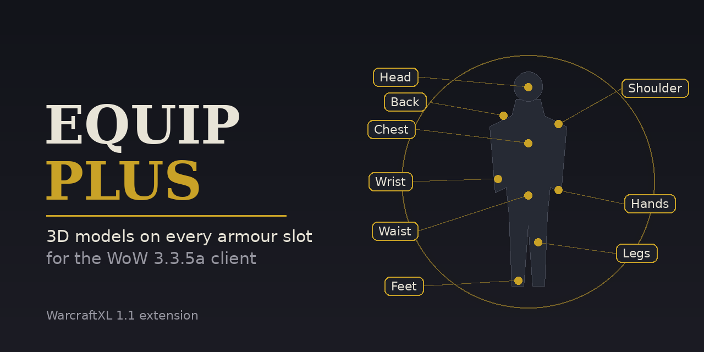

<p align="center">
  
</p>

# wxl-equip-plus

**3D models on every armour slot for the WoW 3.3.5a client, driven entirely by data.**

A [WarcraftXL](https://github.com/WarcraftXL/wxl-core) 1.1 extension. A stock 3.3.5a client can only
draw a model for the head, the shoulders and held items; chest, belt, legs, boots, gloves, bracers,
cloaks, shirts and tabards are painted onto the body as textures and nothing more. Equip Plus lifts
that limit:

- **Two independent M2 models on every armour slot**, attached to any character or NPC wearing the item.
- **Retail collection models** (the single-file armour pieces modern WoW uses) with per-geoset filtering,
  so one collection file can serve the chest, legs, boots and gloves of a set.
- **Bone remapping**, so collection pieces skinned to a retail skeleton follow the 3.3.5a body.
- **Custom weapon models**, including asymmetric off-hand variants and multi-texture weapons.
- **Creature models with more than three textures** and geoset filtering.
- **Equipment animations** synchronised to the wearer.
- **CSV sidecars** for everything a 3.3.5a `ItemDisplayInfo.dbc` row has no column for, so retail
  data can be used without packing it into DBC fields.

Driven by `ItemDisplayInfo.dbc`, `CreatureDisplayInfo.dbc` and optional CSV files. No client code
changes per item.

---

## Where this comes from

Equip Plus is a maintained, Hub-packaged continuation of two earlier projects, with thanks to both:

- [**Morfium-G/wxl-equip-extension**](https://github.com/Morfium-G/wxl-equip-extension), the original
  module, written when extensions were compiled into `WarcraftXL.dll`. It has not been updated for the
  WarcraftXL 1.1 extension system.
- [**Atraxian123/WXL-Equip-Creature-Extension-CSV-WXL11**](https://github.com/Atraxian123/WXL-Equip-Creature-Extension-CSV-WXL11),
  which ported it to the 1.1 extension ABI and added weapons, creatures, CSV sidecars and equipment
  animations. This repository carries its full commit history.

Also credited: [iThorgrim](https://github.com/iThorgrim) for WarcraftXL itself, and
[Furioz420](https://github.com/Furioz420) for the original CSV sidecar implementation.

What this repository adds on top of Atraxian's port:

- A distinct id (`wxl-equip-plus`), so it can never overwrite, or be overwritten by, an updated
  `wxl-equip-extension`. The manifest declares the two as conflicting: install one or the other.
- A `wxl.json` manifest and store listing, so it appears in the WXL Hub.
- A GitHub Actions workflow that builds the DLL against the current `wxl-core` v1.1 and publishes it as
  a release on every push, so nobody has to build it themselves.
- Documentation tidied and brought up to date.

---

## Requirements

- WoW 3.3.5a, build 12340.
- [WarcraftXL](https://github.com/WarcraftXL/wxl-core) core **1.1**.
- Not to be installed alongside `wxl-equip-extension`: both drive the same hooks.

## Installing

**Through the WXL Hub (recommended):** find **Equip Plus** in the store and press Install.

**By hand:** download `wxl-equip-plus.dll` from the
[latest release](../../releases/latest) and place it at:

```
<WoW folder>\Extensions\wxl-equip-plus\wxl-equip-plus.dll
```

The folder name and the DLL name must match; that is how WarcraftXL finds an extension.

**Optional settings:** copy `Samples and instructions\WXLExtendedEquipment.ini` into your WoW folder
(next to `Wow.exe`) to cap the memory used by baked creature models. Without it, the defaults apply.

**In-game panel:** open the WarcraftXL overlay (F9) and choose **Equip Plus**. It shows how many CSV
rows are loaded, how many models are attached right now, and how many stale stock rows and missing model
files it has protected you from this session. It can switch the log on and off, and **Reload CSV files**
re-reads every sidecar without restarting the client - edit a CSV, reload, re-equip the item.

**Debug logging:** off by default because it sits on very hot render paths. Create an empty file called
`WarcraftXL_equip.log.enable` in the WoW folder, or set the environment variable `WXL_EQUIP_LOG=1`, and
the extension writes `WarcraftXL_equip.log`.

**Switching it off without uninstalling:** create an empty file called `WarcraftXL_equip-plus.disable`
in the WoW folder.

## Building from source

Every push to `main` is built by GitHub Actions (see `.github/workflows/release.yml`). To build locally
you need Visual Studio 2022 (Desktop development with C++) and CMake:

```powershell
git clone -b v1.1 https://github.com/WarcraftXL/wxl-core.git
git clone https://github.com/TheDaveCalaz/wxl-equip-plus.git
New-Item -ItemType Directory -Force wxl-core\extensions\wxl-equip-plus | Out-Null
Copy-Item wxl-equip-plus\src wxl-core\extensions\wxl-equip-plus -Recurse
cmake -S wxl-core -B wxl-core\build -A Win32
cmake --build wxl-core\build --config Release --target wxl-equip-plus
```

The DLL is written to `wxl-core\build\Release\wxl-equip-plus.dll`.

---

## Backport Helper - retail sets, step by step

Not comfortable with command lines? Double-click **`Backport Helper.bat`** in this repository's folder. It
asks where your kit, client and server are once, then gives you a menu:

1. **Add something** - search retail by name and tick what you want.
2. **Build** - runs every backport-kit step in order and explains, in plain English, any that fails.
3. **Install** - backs up what it replaces, then updates `patch-X` (the sets) and `patch-W` (their 3D
   pieces for Equip Plus), clears the client cache, merges your server's tables without losing your own
   rows, and runs the item SQL. It offers to install Equip Plus if it is missing.
4. **Undo last install** - puts everything back.

It follows the rules that are easy to get wrong by hand: one kit project for everything, never re-scanning
while the kit's own patch is installed, reusing the same `patch-W`, and asking before it touches the
server. Your database password is asked for each time and never saved. Details in
[`tools/README.md`](tools/README.md).

---

## Retail sets from the backport kit

[wow-retail-backport](https://github.com/Kirazul/wow-retail-backport) converts a retail armour set for the
3.3.5a client, and with `build --extension` exports the 3D pieces only an extension can draw. Equip Plus
ships a converter that turns that export into a ready-to-copy folder patch - models renamed, colourway
textures included, CSV rows written:

```powershell
python tools\backport_to_equipplus.py --work C:\Backport\Lionguard
```

See [`tools/README.md`](tools/README.md).

---

## Quick start: a 3D belt

The smallest useful example. Give an item display a belt buckle model on the BeltBuckle attachment,
without editing the DBC, by adding one row to `DBFilesClient\WXLItemDisplayModels.csv` (loose, or
inside any patch MPQ):

```csv
DisplayID,ItemID,Slot,Layer,Side,Folder,Model,Texture,Geosets,Attach,SuffixPolicy,TexturePolicy,Flags
69019,,Waist,Base,C,Waist,my_belt_buckle.mdx,my_belt_buckle_texture,,53,Exact,Exact,
```

That loads `Item\ObjectComponents\Waist\my_belt_buckle.mdx` with the texture
`Item\ObjectComponents\Waist\my_belt_buckle_texture.blp`. `SuffixPolicy` decides whether the extension
appends the race and gender to the model name (`Exact` uses the name as written). Full column
references follow.

**Which slots take which kind of model (CSV sidecars).** A plain, standalone model is accepted on the
head, shoulders, waist, back, tabard and weapon slots. Chest, legs, feet, hands and wrists accept only
*collection* models: set `Folder` to `Collections`, or give a geoset filter, or both. A plain model
named for one of those slots is skipped (and logged, when logging is on).

The sample DBCs and CSVs in `Samples and instructions/` show complete armour, weapon and creature setups.

---

## What changes in `ItemDisplayInfo.dbc`

### Slot coverage

Vanilla 3.3.5a only supports `ModelName_1`, `ModelName_2`, `ModelTexture_1`, and `ModelTexture_2` for Head and Shoulder slots. This module extends support to the slots listed below. Slots not listed (Neck, Rings, Trinkets, weapons) are deferred and not yet handled.

| Slot | Model1 | Model2 | Texture1 | Texture2 | Icon2 settings |
|------|--------|--------|----------|----------|----------------|
| Head | was partial | **added** | - | **added** | **added** |
| Shoulder | was partial | was partial | -  | - | **added** |
| Shirt | **new** | **new** | **new** | **new** | **new** |
| Chest | **new** | **new** | **new** | **new** | **new** |
| Waist | **new** | **new** | **new** | **new** | **new** |
| Legs | **new** | **new** | **new** | **new** | **new** |
| Feet | **new** | **new** | **new** | **new** | **new** |
| Wrist | **new** | **new** | **new** | **new** | **new** |
| Hands | **new** | **new** | **new** | **new** | **new** |
| Back | **new** | **new** | **new** | **new** | **new** |
| Tabard | **new** | **new** | **new** | **new** | **new** |

Each equipped item can now attach up to **two independent M2 models** to any character or NPC wearing that armor.

---

### `ModelName_1` and `ModelName_2` — geoset filtering and collections

The model name fields work as before for simple per-slot models. Two new capabilities are added:

#### Collection M2s

Append a colon and a comma-separated list of geoset IDs to activate a collection:

```
chestplate_paladin_tier2.mdx:1201,2301
```

- The `:` switches the model lookup path from the per-slot directory (`Item\ObjectComponent\<SlotName>\`) to the shared collections directory (`Item\ObjectComponent\collections\`). This matches the retail pathing, so retail-exported collection M2s can be used without renaming.
- Geoset IDs listed after `:` are the **only** geosets that will render. All others are hidden. Geoset `0` (always-on geometry) is never filtered out.
- Combine with **flag `0x40`** (new suffix format) if the collection uses the modern `Race_Gender` naming convention.

#### Standard (non-collection) models

No colon in the name: the lookup path is the normal per-slot directory, suffixed with race and gender as usual (controlled by flags in Icon2, see below).

---

### `ModelTexture_1` and `ModelTexture_2`

These columns work exactly as they did for Head and Shoulders. No format change — they are now honoured for all equippable slots.

---

## Optional WXL sidecar CSVs

DBC still remains the primary source, but the module can also read sidecar CSVs when retail data needs more structure than `ItemDisplayInfo.dbc` provides.

Sidecars are searched in:

- `WXLItemDisplayModels.csv`
- `DBFilesClient\WXLItemDisplayModels.csv`
- `WXLItemDisplayModelMaterials.csv`
- `DBFilesClient\WXLItemDisplayModelMaterials.csv`
- `WXLItemEntryDisplay.csv`
- `DBFilesClient\WXLItemEntryDisplay.csv`
- `WXLCreatureModels.csv`
- `DBFilesClient\WXLCreatureModels.csv`
- `WXLCreatureTextures.csv`
- `DBFilesClient\WXLCreatureTextures.csv`
- `WXLWeaponModels.csv`
- `DBFilesClient\WXLWeaponModels.csv`
- `WXLWeaponTextures.csv`
- `DBFilesClient\WXLWeaponTextures.csv`
- `WXLHelmOffsets.csv`
- `DBFilesClient\WXLHelmOffsets.csv`

- the same `DBFilesClient\...` paths inside every `Data\*.MPQ` patch, including open-folder `.MPQ` patches

Sidecar reads use the client file system first and then the game's IO layer, so packed MPQs and open `.MPQ` folders both work.

### `WXLItemDisplayModels.csv`

Adds structured model rows for a display ID. If at least one model sidecar row exists for a display, the DBC model lists for that display are skipped.

Common columns:

| Column | Meaning |
|--------|---------|
| `DisplayID` | ItemDisplayInfo ID. Required. |
| `ItemID` | ID of the item. Leave empty. (candidate for removal) |
| `Slot` | Slot name or internal model slot index. Examples: `Head`, `Shoulder`, `Chest`, `Glove`, `8`. |
| `Layer` | Layer of the baked model. Keep Base for now (possible candidate for removal) |
| `Side` | Side from where the model should appear: L, R or C (possible candidate for removal) |
| `Folder` | Optional object component folder override, e.g. `Head`, `Shoulder`, `Collections`. |
| `Model` / `ModelStem` / `ModelName` | Model stem or path. Required. May include `:geosets`. |
| `Texture` / `TextureStem` / `ModelTexture` | Optional model texture stem. |
| `Geosets` | Optional comma-separated geoset filter. Overrides any `:geosets` suffix in `Model`. |
| `Attach` | Optional explicit attachment ID. |
| `SuffixPolicy` | `Exact`/`None`, `Retail`/`New`, `Legacy`/`Race`, or `DBC`/`Slot`. |
| `TexturePolicy` | Same idea as `SuffixPolicy`, but for texture suffixing. |
| `Flags` | Extra Icon2-style model flags. |

### `WXLItemDisplayModelMaterials.csv`

Applies model-specific material textures, including special retail layers that should not be packed into `ModelTexture_1/2`.

Common columns:

| Column | Meaning |
|--------|---------|
| `DisplayID` | ItemDisplayInfo ID. Required. |
| `ModelIndex` | Retail model index or part index. |
| `ModelColumn` | `ModelName_1`, `ModelName_2`, `1`, or `2`. |
| `Model` | Optional model stem filter. |
| `TextureType` | Retail texture type for the material row. |
| `Folder` | Optional object component folder for texture pathing. |
| `Texture` | Texture stem, or `__hide__...` for intentional hidden material rows. Required. |
| `TargetMode` | Targeting behaviour, keep `SkinMapOnly`. |

Targeted material rows are applied to virtual collection models instead of globally replacing the model's main texture.

### `WXLHelmOffsets.csv`

Applies model-specific material offsets for Helm models and other collections models.

| Column | Meaning |
|--------|---------|
| `Model` | Name of the model where to apply the modifications. |
| `RaceSex` | Additional filter for specific race/sex combinations for the modifications. |
| `Mode` | Mode of the modifications: can be Add, None or others (see the code) |
| `Kind` | Kind of model to modify, generally reserved to Helm or Collection. |
| `X Y Z` | Offsets to add to the model. |
| `Scale` | Scale multiplier for the model (generally not used, but for some collections Tauren Females need 0.8 and Tauren Males need 0.75. |

This CSV is used to apply scale and offset modifications to helm models and to collection models.
The Extension will apply the helm offset corrections if the root of the helm model is specified in this .CSV

### `WXLEquipAnimations.csv`

Introduced a system to synch items animations to character's animations, if the ItemDisplayId is not present, animations synch is ignored by default.

| Column | Meaning |
|--------|---------|
| `ItemDisplayID` | DisplayID of the items you want to have animations synch. |
| `Animations` | 1 for activating animations, 0 for ignoring. |


### `WXLWeaponModels.csv`

Sidecar used to declare weapon models to bake and their geosets

| Column | Meaning |
|--------|---------|
| `DisplayID` | item display ID entry as in the ItemDisplayInfo.dbc |
| `ModelPath` | full path of the model to use for pre-loading ending with the .mdx extension |
| `Model2Path` | full path of the model to use for pre-loading ending with the .mdx extension |
| `Geoset1` | geosets of the model 1 that will be rendered: empty for all geosets, 0 for only the base skin geosets, "xxxx, yyyy, ..." to render multiple geosets |
| `Geoset2` | geosets of the model 2 that will be rendered: empty for all geosets, 0 for only the base skin geosets, "xxxx, yyyy, ..." to render multiple geosets |
| `Model1OffhandPath` | full path of the model to use for pre-loading ending with the .mdx extension for custom offhand model (optional)|
| `Model2OffhandPath` | full path of the model to use for pre-loading ending with the .mdx extension for custom offhand model (optional)|
| `Geoset1Offhand` | geosets of the model 1 that will be rendered: empty for all geosets, 0 for only the base skin geosets, "xxxx, yyyy, ..." to render multiple geosets for custom offhand model (optional)|
| `Geoset2Offhand` | geosets of the model 2 that will be rendered: empty for all geosets, 0 for only the base skin geosets, "xxxx, yyyy, ..." to render multiple geosets for custom offhand model (optional)|
| `NoAutoMirror` | Opt out of the auto mirror for offhand models (NOT YET IMPLEMENTED) |

Generally weapons only have 1 model and only skin geosets, but I wanted to give the option to modders to make complex weapons if they wanted.
Also added support for custom models for the offhand version of the weapon. If you want a mirrored model of, let's say, a glaive weapon you will have to add it to the offhand model and provide the model yourself (mainly through WoW Blender Studio import and modifications)
An auto-mirroring feature is in the works and not yet implemented.

### `WXLWeaponTextures.csv`

Sidecar for declaring the textures to bake into the weapons

| Column | Meaning |
|--------|---------|
| `DisplayID` | item display ID entry as in the ItemDisplayInfo.dbc |
| `ModelColumn` | 0 or 1 depending if the textures must be baked on the first or second model declared in the previous .csv |
| `TextureType` | Texture Type of the texture to be baked. See tables below for reference. |
| `TexturePath` | full path of the texture file to be baked |

### `WXLCreatureModels.csv`

Sidecar used to specify which CreatureDisplayID and Creature Models have to be pre-loaded and with which visible geosets

| Column | Meaning |
|--------|---------|
| `DisplayID` | creature display ID entry as in the CreatureDisplayInfo.dbc |
| `CreatureModelPath` | full path of the model to use for pre-loading ending with the .mdx extension eg. creature\manawyrm2mount\manawyrm2mount.mdx |
| `Geoset` | geosets of the model that will be rendered: empty for all geosets, 0 for only the base skin geosets, "xxxx, yyyy, ..." to render multiple geosets |

Virtual models are built lazily, the first time a display is requested (eager preloading is disabled in code). Note that having many models pre-loaded this way will be very memory intensive. Beware of the 4GB ram cap for the 32bit client.

### `WXLCreatureTextures.csv`

Sidecar used to specify which textures will be baked into the virtual pre-loaded creature model.

| Column | Meaning |
|--------|---------|
| `DisplayID` | creature display ID entry as in the CreatureDisplayInfo.dbc |
| `TextureType` | Texture Type of the texture that will be baked into the pre-loaded model, see the table later in the readme |
| `TexturePath` |  full path of the texture to bake in the pre-loaded model. eg. creature\manawyrm2mount\manawyrm2mount_armor_1.blp |

Note that if the monster model in the CreatureDisplayInfo.dbc entry already has textures declared (for example Monster_1 _2 or _3) adding them into this sidecar will get precedence over the .dbc entry. 

### `Changes to the CreatureModelData.dbc and CreatureDisplayInfo.dbc`

To allow for easy loading of the pre-loaded models by the client, a suffix must be added to the name of the model in the CreatureModelData.dbc.
The suffix is _xxxx there xxxx is the CreatureDisplayID that is specified in the WXLCreatureModel.csv sidecar.

For example: creature\manawyrm2mount\manawyrm2mount.mdx with display ID 33113 will become creature\manawyrm2mount\manawyrm2mount_33113.mdx
Otherwise the new virtual model will be pre-loaded, but never used by the client.

The corresponding CreatureDisplayInfo.dbc entry will have to specify the correct model id from the CreatureModelData.dbc.

---


### `Icon2` — attachment point and flag configuration

The `Icon2` field is unused in stock 3.3.5a and is repurposed to configure how Model1 and Model2 are loaded and attached.

**Format:** `<model1_attachment>:<model2_attachment>:<flags>`

All three parts are optional. Omit a value to keep the slot default. Examples:

| Icon2 value | Meaning |
|-------------|---------|
| *(empty)* | Use slot defaults for both attachment points and all flags |
| `11:55` | Model1 on attachment 11, Model2 on attachment 55 |
| `:34` | Model2 on attachment 34, Model1 uses slot default |
| `::6` | Flags = `0x4 \| 0x2` (no gender or race suffix), attachments at defaults |
| `19:19` | Both models on attachment 19 (Ground_Base) |
| `::96` | Flags = `0x20 \| 0x40` (subfolder + new suffix format), attachments at defaults |

#### Flags

| Flag | Name | Effect |
|------|------|--------|
| `0x1` | Hide built-in geosets | Skip the normal slot geoset rendering. Use when the M2 model contains all the geometry and the built-in slot geosets should not show. |
| `0x2` | No gender suffix | Do not append `_M` / `_F` to the model path. Use for gender-neutral models. Combine with `0x4` to strip both suffixes entirely (the separator `_` is also skipped). |
| `0x4` | No race suffix | Do not append the race code to the model path. Combine with `0x2` to strip both suffixes. |
| `0x8` | Append race to texture | Append the race code to the texture path (textures are normally not suffixed). |
| `0x10` | Append gender to texture | Append the gender code to the texture path. |
| `0x20` | Model in subfolder | Place the model in a subfolder named after the base model (without suffixes). For example, `chestplate_paladin_tier2_HuF.mdx` resolves to `Item\ObjectComponent\Chest\chestplate_paladin_tier2\chestplate_paladin_tier2_HuF.mdx`. Texture paths follow the same subfolder. Useful for packaging models for easy distribution and merging. |
| `0x40` | New suffix format | Use the retail naming convention with an extra underscore between race and gender: `Hu_F` instead of `HuF`. Only applies when the model or texture actually needs suffixing (i.e. `0x2`/`0x4` are not both set, or `0x8`/`0x10` are both set). Lets you use retail-exported models without renaming. |

---

## Default attachment points per slot

If no attachment is specified in `Icon2`, the following defaults apply:

| Slot | Model1 attachment | Model2 attachment |
|------|-------------------|-------------------|
| HEAD | 11 (Helmet) | 55 (HeadTop) |
| SHOULDER | 6 (Left Shoulder) | 5 (Right Shoulder) |
| SHIRT | 34 (Chest) | 34 (Chest) |
| CHEST | 34 (Chest) | 34 (Chest) |
| WAIST | 53 (BeltBuckle) | 53 (BeltBuckle) |
| LEGS | 9 (HipRight) | 10 (HipLeft) |
| FEET | 47 (LeftFoot) | 48 (RightFoot) |
| WRIST | 3 (ElbowRight) | 4 (ElbowLeft) |
| HANDS | 1 (HandRight) | 2 (HandLeft) |
| BACK | 12 (Back) | 12 (Back) |
| TABARD | 34 (Chest) | 34 (Chest) |

---

## Known issues

**Stale stock DBC entries (handled).** Stock 3.3.5a `ItemDisplayInfo.dbc` was never cleaned of model
names copied between rows. A typical client has several hundred glove, boot, bracer, belt, chest and leg
displays whose `ModelName_1`/`ModelName_2` still name a helm or shoulder model. They did nothing in the
base game, but an extension that honours those columns turns each one into a checkered box, a crash, or
a pauldron hanging from a belt buckle - on NPCs and bots as much as on players. The original
wxl-equip-extension asked you to clean the DBC by hand. Equip Plus guards against it in code:

- On chest, legs, feet, hands and wrists, a plain (non-collection) model from the DBC is ignored.
- On every slot other than head and shoulders, a DBC model whose name starts with `Helm_`, `Shoulder_`,
  `LShoulder_` or `RShoulder_` is ignored, unless the row sets `Icon2` - the signal that someone
  configured it on purpose.
- Every model, from the DBC or a CSV sidecar, must exist in the client's files before it is loaded. A
  missing model is skipped and logged rather than attached.

Measured against a real AzerothCore client: 680 stale armour displays (1,013 items) are present; after
the first two rules a single belt row still names a model (a one-handed club), and the existence check
skips it.

**Missing textures** fall back to the client's built-in placeholder texture rather than failing.

---

## Future Plans

Adding support for real-time auto-mirroring of the main hand model for offhand equipment.
Migrating most of the extension-native hooks and functions to ones already present in the new Core.
Adding support for armor skin textures without having to add the _u suffix and/or convert them to .png then back to palleted .blp with 256 colors.
How-to tutorials for collections and weapons (low priority)

---

## Attachment point reference

The IDs below are the attachment slots present on retroported HD character models:

```c
typedef enum<uint32> {
    AT_Shield_MountMain_ItemVisual0 = 0,
    AT_HandRight_ItemVisual1        = 1,
    AT_HandLeft_ItemVisual2         = 2,
    AT_ElbowRight_ItemVisual3       = 3,
    AT_ElbowLeft_ItemVisual4        = 4,
    AT_Right_Shoulder               = 5,
    AT_Left_Shoulder                = 6,
    AT_Right_Knee                   = 7,
    AT_Left_Knee                    = 8,
    AT_HipRight                     = 9,
    AT_HipLeft                      = 10,
    AT_Helmet                       = 11,
    AT_Back                         = 12,
    AT_ShoulderFlapRight            = 13,
    AT_ShoulderFlapLeft             = 14,
    AT_Bust_ChestBloodFront         = 15,
    AT_Bust2_ChestBloodBack         = 16,
    AT_Face_Breath                  = 17,
    AT_AboveChar_PlayerName         = 18,
    AT_Ground_Base                  = 19,
    AT_Top_of_Head                  = 20,
    AT_SpellLeftHand                = 21,
    AT_SpellRightHand               = 22,
    AT_Special1                     = 23,
    AT_Special2                     = 24,
    AT_Special3                     = 25,
    AT_SheathMainHand               = 26,
    AT_SheathOffHand                = 27,
    AT_SheathShield                 = 28,
    AT_Belly_PlayerNameMounted      = 29,
    AT_LargeWeaponLeft              = 30,
    AT_LargeWeaponRight             = 31,
    AT_HipWeaponLeft                = 32,
    AT_HipWeaponRight               = 33,
    AT_Chest                        = 34,
    AT_HandArrow                    = 35,
    AT_Bullet                       = 36,
    AT_DemolisherVehicle1           = 37,
    AT_DemolisherVehicle2           = 38,
    AT_Vehicle_Seat1                = 39,
    AT_Vehicle_Seat2                = 40,
    AT_Vehicle_Seat3                = 41,
    AT_Vehicle_Seat4                = 42,
    AT_Vehicle_Seat5                = 43,
    AT_Vehicle_Seat6                = 44,
    AT_Vehicle_Seat7                = 45,
    AT_Vehicle_Seat8                = 46,
    AT_LeftFoot                     = 47,
    AT_RightFoot                    = 48,
    AT_ShieldNoGlove                = 49,
    AT_SpineLow                     = 50,
    AT_AlteredShoulderR             = 51,
    AT_AlteredShoulderL             = 52,
    AT_BeltBuckle                   = 53,
    AT_SheathCrossbow               = 54,
    AT_HeadTop                      = 55,
    AT_VirtualSpellDirected         = 56,
    AT_Backpack                     = 57,
    AT_Unk_58                       = 58,
    AT_Unk_59                       = 59,
    AT_Unk_60                       = 60,
} ATTACHMENT_ID;
```
----

## Texture Names Reference

Textures in models have a known enumerator, if you for example are using WoW Blender Studio to edit models you would have surely noticed that changeable textures come with different names instead of a numeric type, those names point to an enumerator and the .csv sidecar cares about that enumerator Texturee.

|Texture Name | Texture Type |Texture Name | Texture Type |
|-------------|--------------|-------------|--------------|
|Hardcoded|0|Monster 3|13|
|Skin|1|Item Icon|14|
|Object Skin|2|Guild Background Color|15|
|Weapon Blade|3|Guild Emblem Color|16|
|Weapon Handle|4|Guild Border Color|17|
|Environment|5|Guild Emblem|18|
|Hair|6|Eyes|19|
|Facial Hair|7|Accessory|20|
|Skin Extra|8|Secondary Skin|21|
|UI Skin|9|Secondary Hair|22|
|Tauren Mane|10|Unknown 23|23|
|Monster 1|11|Unknown 24|24|
|Monster 2|12|-|-|

Ths repository has been tested with ulatek weapons that have Object Skin, Weapon Blade, Weapon Handle and Unknown 24 changeable textures.

---

## Geoset Names Reference

Like textures, also geosets in models have a known name attached to an enumerator. This table will save you the headache of figuring out what enumerator corresponds to what name. You can then associate the geoset number with the geoset name. Woe.export uses geoset names instead of geoset numbers, for example, but the .dbc edits will use the geoset number.

|Geoset Name|Geoset Number|Geoset Name|Geoset Number|Geoset Name|Geoset Number|
|-----------|-------------|-----------|-------------|-----------|-------------|
|Skin|0|Eye Effect|17xx|Necklace|36xx|
|Hair|1xx|Belt|18xx|Headdress|37xx|
|Facial 1|1xx|Bone/Trail|19xx|Tails|38xx|
|Facial 2|2xx|Feet|20xx|MiscAccessory|39xx|
|Facial 3|3xx|BE_NE_Hands/HandAttach|23xx|MiscFeature|40xx|
|Glove|4xx|Horns/HeadAttach|24xx|Noses|41xx|
|Boots|5xx|Head/DHBlindfolds|25xx|HairDecoration|42xx|
|Shirt|6xx|Torso|22xx|HornDecoration|43xx|
|Ears|7xx|Shoulders|26xx|BodySize|44xx|
|Wristbands|8xx|Helmet|27xx|Unknown1|45xx|
|Kneepads|9xx|ArmUpper|28xx|Unknown2|46xx|
|Chest|10xx|ArmsReplace/MechagnomeArms|29xx|Unknown3|47xx|
|Pants|11xx|LegsReplace/MechagnomeLegs|30xx|Unknown4|48xx|
|Tabard|12xx|FeetReplace/MechagnomeFeet|31xx|Unknown5|49xx|
|Trousers|13xx|HeadSwap|32xx|Unknown6|50xx|
|Loincloth|14xx|Eyes|33xx|EyeGlows|51xx|
|Cape|15xx|Eyebrows|34xx|-|-|
|Facialjewelry|16xx|Piercing/Earring|35xx|-|-|

In short, if you are looking at a collections model in Wow.Expor and you see a model with a Chest1 geoset, that geoset corresponds to 1001 or HandAttach3 that geoset corresponds to 2303

---